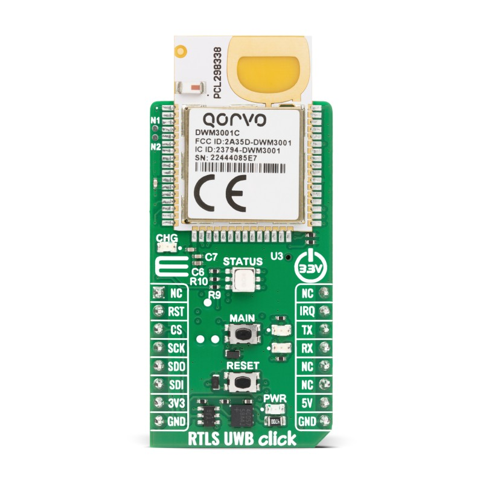
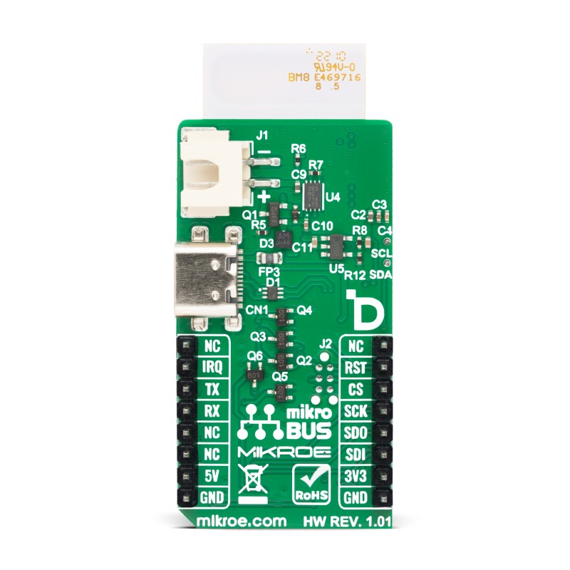
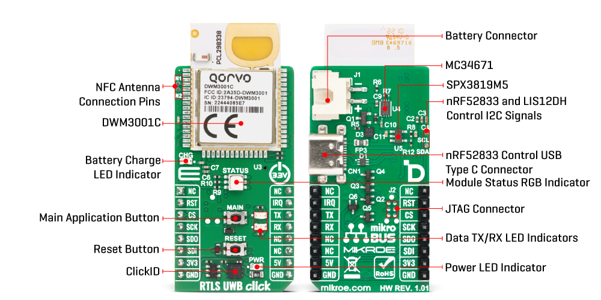
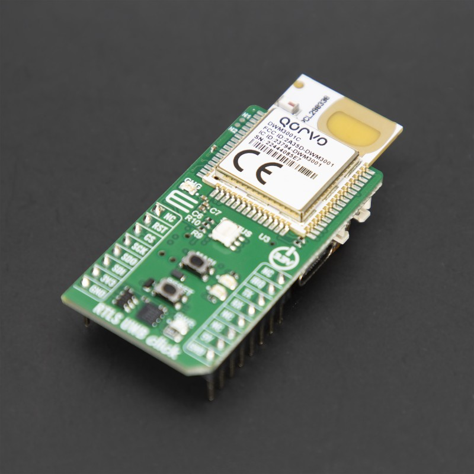
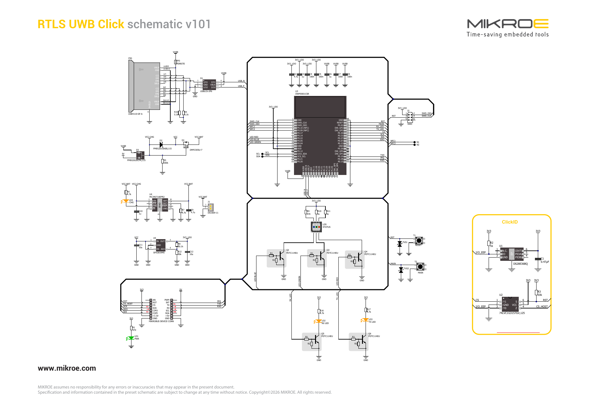

## Propuesta ##

**Tipo de trabajo:** réplica.

**Placa de referencia:** RTLS UWB Click (MIKROE-6863), HW rev. 1.01, de MikroElektronika.
Se basa en el módulo Qorvo **DWM3001C**, que integra el transceptor UWB DW3110, el SoC BLE nRF52833, el acelerómetro LIS2DH12 y la antena UWB.

**Alcance propuesto:** réplica casi fiel de la placa. La única modificación es **eliminar el bloque ClickID** (U1 DS28E36BQ, U2 74LVC1G3157, R2, R3, C1). Por lo tanto, la línea CS del mikroBUS va directo a `CS_HOST` del módulo.
El objetivo es estudiar y reproducir un diseño comercial bien resuelto (RF/antena, carga de batería Li-ion, USB-C, regulación) sin introducir cambios grandes.

### Fuentes ###
* Página del producto: https://www.mikroe.com/rtls-uwb-click
* Esquemático de referencia v101: https://download.mikroe.com/documents/add-on-boards/click/rtls-uwb-click/rtls-uwb-click-schematic.pdf (copia local: [rtls-uwb-click-schematic-v101.pdf](rtls-uwb-click-schematic-v101.pdf))
* Archivos 2D/3D (STEP y DXF del contorno): https://download.mikroe.com/documents/2d-3d-files/RTLS_UWB_Click_v101_2d_3d_files.zip (copia local en [../../info/cad](../../info/cad))
* Hoja de datos DWM3001C: https://download.mikroe.com/documents/datasheets/DWM3001C_datasheet.pdf
* Librerías mikroSDK: https://github.com/MikroElektronika/mikrosdk_click_v2

### Imágenes de la placa ###

Cara superior (TOP):

Cara inferior (BOTTOM):

Ambas caras, con los bloques funcionales señalados (imagen del fabricante):

Vista en perspectiva:

### Circuito esquemático de referencia ###

### Bloques principales ###
| Ref. | Componente | Función |
|---|---|---|
| U3 | Qorvo DWM3001CSR | Módulo UWB + BLE (nRF52833) + acelerómetro |
| U4 | NXP MC34671AEPR2 | Cargador de batería Li-ion |
| U5 | MaxLinear SPX3819M5 | LDO 3,3 V (3V3_LDO) |
| CN1 | GCT USB4110-GF-A | Conector USB Type-C (USB del nRF52833) |
| D1 | ST USBLC6-2P6 | Protección ESD de USB |
| Q1 | Diodes DMP2305U-7 | MOSFET P para conmutar entre batería y alimentación externa |
| D2, D3 | Nexperia PMEG2010AEB / PMEG3020CPA | Schottky para la selección de alimentación |
| Q2–Q6 | Nexperia PDTC114EU | Transistores con resistencias integradas para los LEDs |
| J1 | — | Conector de batería |
| J2 | — | Conector SWD de programación |
| ~~U1, U2~~ | ~~DS28E36BQ, 74LVC1G3157~~ | ~~ClickID~~ (**se elimina**) |
